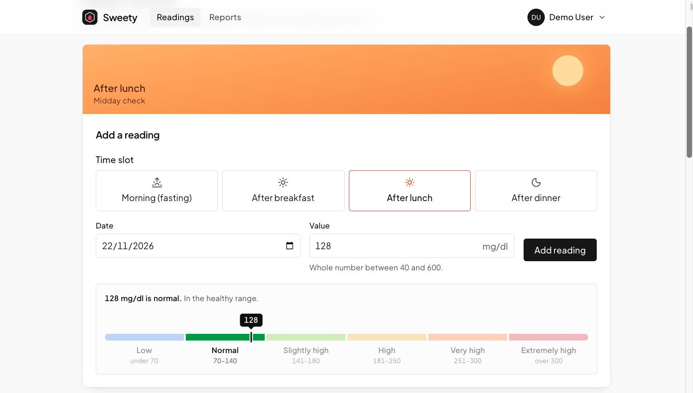
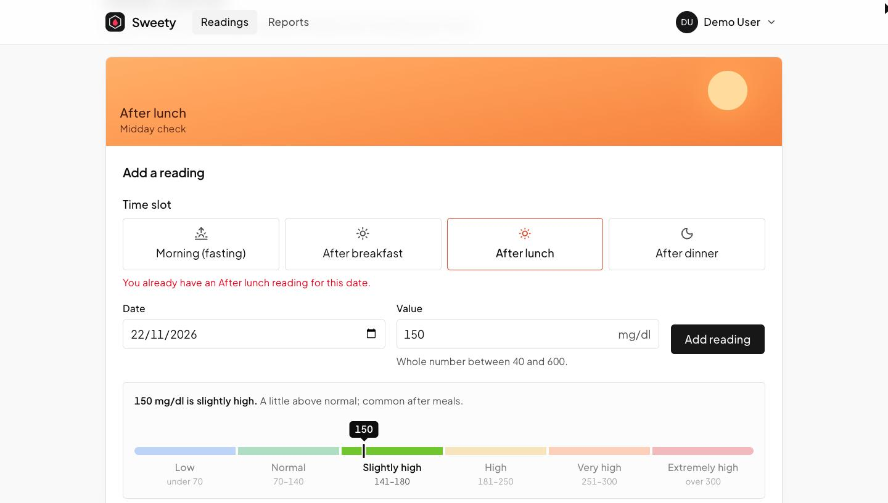
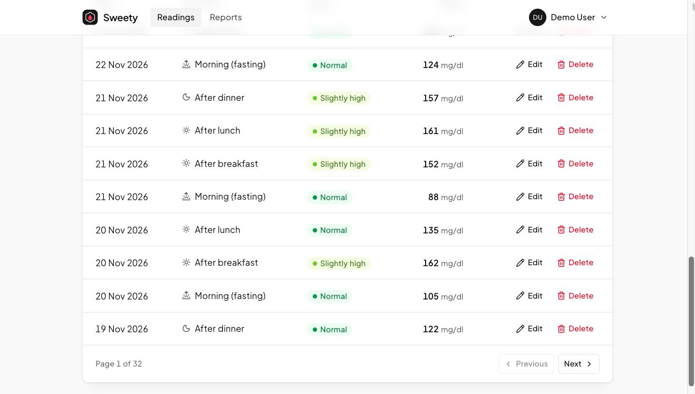
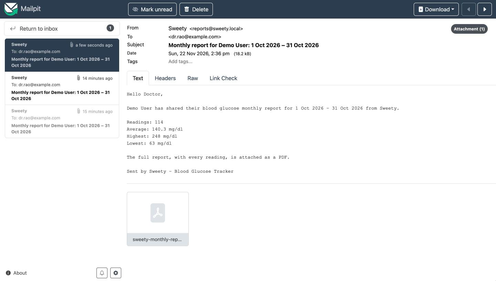
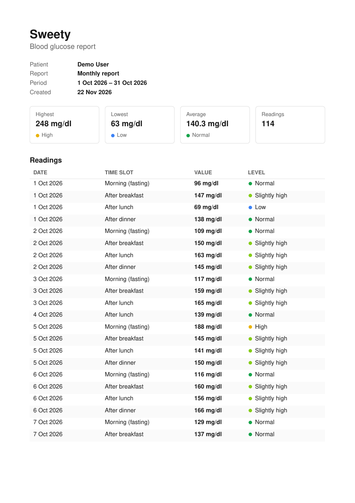

# Sweety – Blood Glucose Tracker

Sweety is a small web app where a person with diabetes records up to **4 blood glucose readings a day** (in mg/dl) and sees **daily, month-to-date and monthly reports**.

Built by Eliyas as the take-home assignment for the **Junior Full Stack Developer – JavaScript & AI** role at **Kenpath Technologies**.

**Stack:** React + Vite (TypeScript) · Node.js + Express (TypeScript) · PostgreSQL · Redis + BullMQ · Docker Compose


---

## Quick start (3 commands)

**You need:** [Node.js 20+](https://nodejs.org) and [Docker Desktop](https://www.docker.com/products/docker-desktop/) (running).

```bash
git clone https://github.com/well-blip/sweety-blood-glucose-tracker.git
cd sweety-blood-glucose-tracker
npm run setup
```

`npm run setup` does everything for you:

1. checks Node.js and Docker are installed
2. creates the `.env` files from `.env.example` (with a random secret for login tokens)
3. installs all packages
4. starts PostgreSQL, Redis and Mailpit in Docker
5. creates the database tables and a **demo user with 3 months of readings**

Then start the app:

```bash
npm run dev
```

| Open | What it is |
|---|---|
| http://localhost:5173 | **The app.** Log in with **`demo@sweety.app`** / **`sweety123`** |
| http://localhost:8025 | **Test inbox** (Mailpit). Reports emailed to a doctor land here; nothing is sent to real email addresses |
| http://localhost:4000/health | The API (returns `{"status":"ok"}`) |

Other commands (run from the project folder):

| Command | What it does |
|---|---|
| `npm test` | Runs all tests (server API tests + React form tests) |
| `npm run seed` | Resets the demo user and their readings |
| `npm run stop` | Stops the Docker containers |

---

## Features

### Sign up and log in
Register with name, email and password, then log in. Passwords are hashed with **bcrypt** (never stored as plain text) and the API gives back a **JWT** that the app sends with every request. Every database query includes the user's id, so a user only ever sees their own readings.

### Add, edit and delete readings
Pick a **time slot** (Morning (fasting), After breakfast, After lunch, After dinner), a **date** and a **value** in mg/dl. The slot is pre-selected from the time of day. While you type, a **colour scale** shows where the value sits, from Low to Extremely high.



Every rule from the brief is checked **on the server** (the source of truth) and **in the browser** (for instant feedback), with the exact messages from the brief:

| Rule | Message |
|---|---|
| Value is required | Please enter a glucose value. |
| Whole number between 40 and 600 | Value must be between 40 and 600 mg/dl. |
| One reading per slot per day | You already have an After lunch reading for this date. |
| At most 4 readings per day | You can add only 4 readings per day. |
| No future dates | Date cannot be in the future. |



### Chart and readings list
An **interactive chart** (Recharts, via shadcn/ui) shows your daily average for the last 7 days, 30 days or 3 months. Each dot is coloured by level, and the green band is the 70–180 mg/dl target range. Below it, your readings are listed newest first, **10 per page**, with Edit and Delete (Delete asks for confirmation first).




### Reports
Choose a date and a report. Each one shows the **highest, lowest and average** (to 1 decimal) and the **number of readings**, or a friendly message when there are none.

| Report | Date range (selected date 15 Oct 2026) |
|---|---|
| Daily | 15 Oct 2026 (also lists each reading with its slot) |
| Month to date | 1 Oct – 15 Oct 2026 |
| Monthly | 1 Sep – 30 Sep 2026 (the whole previous month) |


### Send a report to your doctor (BullMQ background job)
Under any report, enter your doctor's email and click **Email PDF**. The API puts a job on a **BullMQ** queue and answers immediately. A separate **worker** process builds a PDF of the report and emails it, retrying up to 3 times if sending fails. The page shows the progress until it says "Sent".

In this project the email goes to **Mailpit**, a fake mail server running in Docker, so you can open it at http://localhost:8025 and see the email and PDF. No real email is sent.




<details>
<summary>The PDF report (page 1)</summary>



</details>

### Report caching (Redis)
Report results are cached in **Redis** for an hour, and the cache is cleared for that user whenever they add, edit or delete a reading. Responses carry an `X-Cache: HIT` or `MISS` header so you can see it working. If Redis is down, the app still works without the cache.

---

## Manual setup (if you prefer step by step)

`npm run setup` runs these same steps.

```bash
# 1. Install packages
npm install
cd server && npm install && cd ..
cd clientSide && npm install && cd ..

# 2. Create the .env files, then put a long random string in JWT_SECRET in server/.env
cp server/.env.example server/.env
cp clientSide/.env.example clientSide/.env

# 3. Start PostgreSQL, Redis and Mailpit
docker compose up -d

# 4. Create the tables (in the dev and test databases) and the demo user
cd server
npm run db:setup     # warning: drops and recreates the tables
npm run seed
```

Run each part in its own terminal:

```bash
cd server && npm run dev          # API on http://localhost:4000
cd server && npm run worker       # background worker (emails the PDF reports)
cd clientSide && npm run dev      # app on http://localhost:5173
```

Run the tests:

```bash
cd server && npm test             # API tests (needs the Docker containers running)
cd clientSide && npm test         # React form tests
```

---

## Environment variables

Every variable is listed, with safe local defaults, in [`server/.env.example`](server/.env.example) and [`clientSide/.env.example`](clientSide/.env.example). None of them are real secrets.

| Variable | Used for |
|---|---|
| `PORT` | Port the API listens on (4000) |
| `CLIENT_ORIGIN` | The web app's address, allowed by CORS |
| `DATABASE_URL` / `DATABASE_URL_TEST` | PostgreSQL for the app / for the tests |
| `JWT_SECRET` | Signs login tokens (setup generates a random one) |
| `APP_TIMEZONE` | Decides what "today" is (default `Asia/Kolkata`) |
| `REDIS_URL` / `REDIS_URL_TEST` | Redis for the cache and job queue / for the tests |
| `SMTP_HOST` / `SMTP_PORT` / `MAIL_FROM` | Where report emails are sent (Mailpit locally) |
| `VITE_API_URL` (client) | Where the app finds the API |

---

## API

All endpoints except sign up, log in and health need the header `Authorization: Bearer <token>`. Errors look like `{ "error": "message", "fields": { "value": "message" } }`.

| Method | Path | What it does |
|---|---|---|
| POST | `/auth/signup` | Create an account → `{ user, token }` |
| POST | `/auth/login` | Log in → `{ user, token }` |
| GET | `/auth/me` | The logged-in user |
| GET | `/readings?page=1&limit=20` | Your readings, newest first, with `total` and `totalPages` |
| POST | `/readings` | Add `{ date, slot, value }` |
| PUT | `/readings/:id` | Edit a reading |
| DELETE | `/readings/:id` | Delete a reading |
| GET | `/reports?type=daily\|month-to-date\|monthly&date=YYYY-MM-DD` | A report (cached in Redis) |
| GET | `/reports/trend?days=7\|30\|90` | Daily averages for the chart (cached) |
| POST | `/reports/email` | Queue a PDF report email `{ type, date, doctorEmail }` → `202 { jobId }` |
| GET | `/reports/email/:jobId` | Status: `queued`, `sending`, `sent` or `failed` |
| GET | `/health` | Is the API up? |

Slots are sent as `MORNING_FASTING`, `AFTER_BREAKFAST`, `AFTER_LUNCH` or `AFTER_DINNER`.

---

## Project structure

```
├── clientSide/            React app (Vite, TypeScript, Tailwind, shadcn/ui)
│   └── src/
│       ├── pages/         Log in, Sign up, Readings, Reports
│       ├── components/    Reading form, chart, list, colour scale, send-to-doctor card
│       └── lib/           API calls, validation, dates, glucose levels
├── server/                Express API (TypeScript, run with tsx)
│   ├── db/schema.sql      Tables and constraints
│   ├── scripts/           db-setup.ts, seed.ts
│   ├── src/
│   │   ├── routes/        HTTP endpoints (thin: validate, call a service, respond)
│   │   ├── services/      Business logic and SQL (auth, readings, reports, PDF, mail)
│   │   ├── validation/    Zod schemas with the exact messages from the brief
│   │   ├── cache/         Redis client and report cache
│   │   ├── jobs/          BullMQ queue and the report-email job
│   │   └── worker.ts      Background worker process
│   └── tests/             API tests (Vitest + Supertest)
├── docker-compose.yml     PostgreSQL, Redis, Mailpit
├── scripts/setup.mjs      The one-command setup
└── docs/screenshots/
```

---

## Tests

`npm test` runs **92 tests**:

- **Server (63, Vitest + Supertest)** run against a separate test database and test Redis database:
  - sign up and log in
  - every validation rule and its exact message
  - users can't see or change each other's readings
  - add, edit and delete readings, and pagination
  - all three report date ranges, including February, leap years and January
  - averages rounded to 1 decimal
  - cache hits and cache clearing
  - queueing the doctor email, the PDF and the email content
- **Client (29, React Testing Library)** use the reading form like a person would:
  - type values and click buttons
  - check the right message appears
  - check what the form sends to the API
  - check the colour-scale band edges

---

## Notes

### Assumptions
- **"Today"** for the "Date cannot be in the future." rule is worked out on the server in India time (`APP_TIMEZONE=Asia/Kolkata`). The browser uses its own clock for the instant check, the default dates and the pre-selected slot; the server's answer is the final one.
- The **duplicate-slot message** uses the brief's exact wording, so the Morning slot reads "You already have an Morning (fasting) reading for this date."
- The **4-per-day check runs before the duplicate-slot check.** With only 4 slots, a fifth reading always clashes with a slot, so checking slots first would mean "You can add only 4 readings per day." could never appear.
- A value like **`12.5` or `abc`** shows "Value must be between 40 and 600 mg/dl.", because the brief gives one message for the "whole number between 40 and 600" rule.
- **Editing** a reading doesn't count against the 4-per-day limit, so a full day can still be edited.
- **Month to date** includes the selected day. **Monthly** is always the whole previous month, whatever day is selected.
- Emails are **case-insensitive** (`Jane@Example.com` and `jane@example.com` are the same account).
- The **colour scale** (Low under 70, Normal 70–140, Slightly high 141–180, High 181–250, Very high 251–300, Extremely high over 300) follows the common 70–180 mg/dl target range. It uses one scale for every slot and is for information only, not medical advice.
- The UI is made for **older users**: 18px base text, large buttons, mg/dl only, and few choices.
- The **doctor's email** is remembered in the browser only; it isn't saved to the database.
- `npm run db:setup` **drops and recreates** the tables. That's fine for a demo, but a real app would use migrations.
- Docker uses **ports 5433 (Postgres) and 6380 (Redis)** so they don't clash with copies you may already have installed.

### What I'd improve with more time
- **Migrations** (for example node-pg-migrate) instead of drop-and-recreate.
- **One shared validation package** for client and server. The messages and glucose levels are currently written in both.
- **Safer sessions:** httpOnly cookies instead of a token in `localStorage`, plus **rate limiting** on login and report emails.
- **A real email provider** (SES, Resend…) with SMTP login, and the doctor's email saved on the account.
- **Doctor role** (the last bonus task): a doctor account that sees the reports of the patients assigned to them.
- **Different targets for fasting and after-meal readings**, set by the doctor.
- **The daily reminder job** from the brief's BullMQ example, for users with fewer than 4 readings.
- **Production setup:** compile the TypeScript, run the API and worker in Docker too, and add CI to run the tests on every push.
- **End-to-end browser tests** (Playwright) for the full sign-up → add → report flow.
