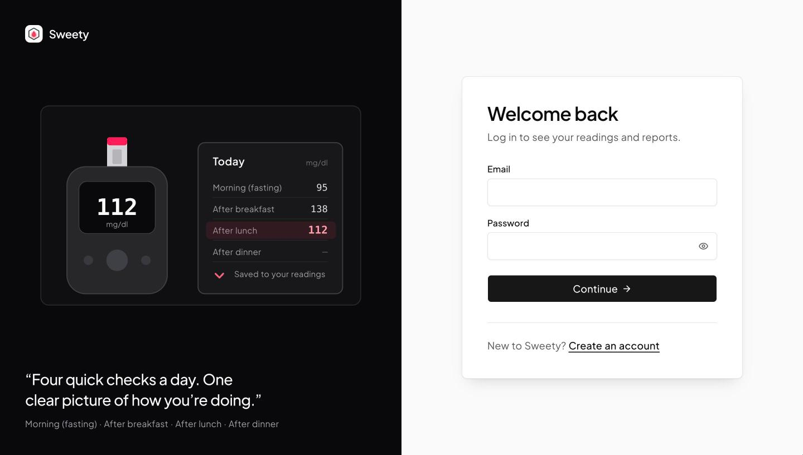
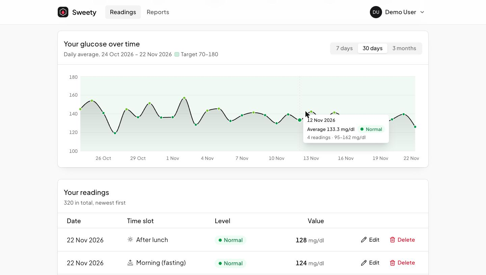
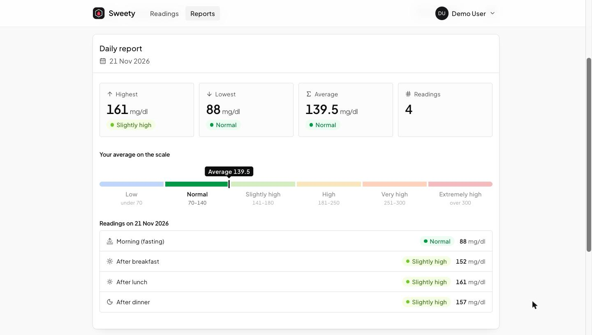
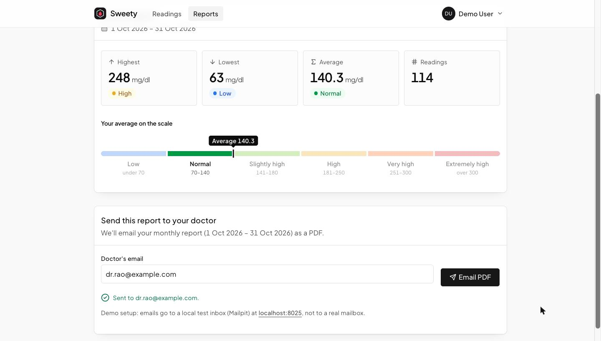

# Sweety – Blood Glucose Tracker

Sweety is a small web app where a person with diabetes records up to **4 blood glucose readings a day** (in mg/dl) and sees **daily, month-to-date and monthly reports**.

Built by Eliyas as the take-home assignment for the **Junior Full Stack Developer – JavaScript & AI** role at **Kenpath Technologies**.

**Stack:** React + Vite (TypeScript) · Node.js + Express (TypeScript) · PostgreSQL · Redis + BullMQ · Docker Compose



---

## Quick start (3 commands)

**You need:** [Node.js 20+](https://nodejs.org) and [Docker Desktop](https://www.docker.com/products/docker-desktop/) (running).

```bash
git clone https://github.com/well-blip/sweety-blood-glucose-tracker.git
cd sweety-blood-glucose-tracker
npm run setup
```

`npm run setup` does everything for you:

1. checks Node.js and Docker are installed
2. creates the `.env` files from `.env.example` (with a random secret for login tokens)
3. installs all packages
4. starts PostgreSQL, Redis and Mailpit in Docker
5. creates the database tables and a **demo user with 3 months of readings**

Then start the app:

```bash
npm run dev
```

This starts the **server** (the API), the **background worker** and the **client** (the web app) together in one terminal. Press `Ctrl+C` to stop them.

| Open | What it is |
|---|---|
| http://localhost:5173 | **The app.** Log in with **`demo@sweety.app`** / **`sweety123`** |
| http://localhost:8025 | **Test inbox** (Mailpit). Reports emailed to a doctor land here; nothing is sent to real email addresses |
| http://localhost:4000/health | The API (returns `{"status":"ok"}`) |

Other commands (run from the project folder):

| Command | What it does |
|---|---|
| `npm test` | Runs all tests: server API tests and client React tests (the Docker containers must be running) |
| `npm run seed` | Resets the demo user and their readings |
| `npm run stop` | Stops the Docker containers |

---

## Features

### Sign up and log in
Register with name, email and password, then log in. Passwords are hashed with **bcrypt** (never stored as plain text) and the API gives back a **JWT** that the app sends with every request. Every database query includes the user's id, so a user only ever sees their own readings.

### Add, edit and delete readings
Pick a **time slot** (Morning (fasting), After breakfast, After lunch, After dinner), a **date** and a **value** in mg/dl. The slot is pre-selected from the time of day. While you type, a **colour scale** shows where the value sits, from Low to Extremely high.


Every rule from the brief is checked **on the server** (the source of truth) and **in the browser** (for instant feedback), with the exact messages from the brief:

| Rule | Message |
|---|---|
| Value is required | Please enter a glucose value. |
| Whole number between 40 and 600 | Value must be between 40 and 600 mg/dl. |
| One reading per slot per day | You already have an After lunch reading for this date. |
| At most 4 readings per day | You can add only 4 readings per day. |
| No future dates | Date cannot be in the future. |


### Chart and readings list
An **interactive chart** (Recharts, via shadcn/ui) shows your daily average for the last 7 days, 30 days or 3 months. Each dot is coloured by level, and the green band is the 70–180 mg/dl target range. Below it, your readings are listed newest first, **10 per page**, with Edit and Delete (Delete asks for confirmation first).




### Reports
Choose a date and a report. Each one shows the **highest, lowest and average** (to 1 decimal) and the **number of readings**, or a friendly message when there are none.

| Report | Date range (selected date 15 Oct 2026) |
|---|---|
| Daily | 15 Oct 2026 (also lists each reading with its slot) |
| Month to date | 1 Oct – 15 Oct 2026 |
| Monthly | 1 Sep – 30 Sep 2026 (the whole previous month) |



### Send a report to your doctor (BullMQ background job)
Under any report, enter your doctor's email and click **Email PDF**. The API puts a job on a **BullMQ** queue and answers immediately. A separate **worker** process builds a PDF of the report and emails it, retrying up to 3 times if sending fails. The page shows the progress until it says "Sent".

In this project the email goes to **Mailpit**, a fake mail server running in Docker, so you can open it at http://localhost:8025 and see the email and PDF. No real email is sent.




<details>
<summary>The PDF report (page 1)</summary>


</details>

### Report caching (Redis)
Report results are cached in **Redis** for an hour, and the cache is cleared for that user whenever they add, edit or delete a reading. Responses carry an `X-Cache: HIT` or `MISS` header so you can see it working. If Redis is down, the app still works without the cache.

---

## Environment variables

Every variable is listed, with safe local defaults, in [`server/.env.example`](server/.env.example) and [`clientSide/.env.example`](clientSide/.env.example). None of them are real secrets.

| Variable | Used for |
|---|---|
| `PORT` | Port the API listens on (4000) |
| `CLIENT_ORIGIN` | The web app's address, allowed by CORS |
| `DATABASE_URL` / `DATABASE_URL_TEST` | PostgreSQL for the app / for the tests |
| `JWT_SECRET` | Signs login tokens (setup generates a random one) |
| `APP_TIMEZONE` | Decides what "today" is (default `Asia/Kolkata`) |
| `REDIS_URL` / `REDIS_URL_TEST` | Redis for the cache and job queue / for the tests |
| `SMTP_HOST` / `SMTP_PORT` / `MAIL_FROM` | Where report emails are sent (Mailpit locally) |
| `VITE_API_URL` (client) | Where the app finds the API |

---

## API

All endpoints except sign up, log in and health need the header `Authorization: Bearer <token>`. Errors look like `{ "error": "message", "fields": { "value": "message" } }`.

| Method | Path | What it does |
|---|---|---|
| POST | `/auth/signup` | Create an account → `{ user, token }` |
| POST | `/auth/login` | Log in → `{ user, token }` |
| GET | `/auth/me` | The logged-in user |
| GET | `/readings?page=1&limit=20` | Your readings, newest first, with `total` and `totalPages` |
| POST | `/readings` | Add `{ date, slot, value }` |
| PUT | `/readings/:id` | Edit a reading |
| DELETE | `/readings/:id` | Delete a reading |
| GET | `/reports?type=daily\|month-to-date\|monthly&date=YYYY-MM-DD` | A report (cached in Redis) |
| GET | `/reports/trend?days=7\|30\|90` | Daily averages for the chart (cached) |
| POST | `/reports/email` | Queue a PDF report email `{ type, date, doctorEmail }` → `202 { jobId }` |
| GET | `/reports/email/:jobId` | Status: `queued`, `sending`, `sent` or `failed` |
| GET | `/health` | Is the API up? |

Slots are sent as `MORNING_FASTING`, `AFTER_BREAKFAST`, `AFTER_LUNCH` or `AFTER_DINNER`.

---

## Project structure

```
├── clientSide/            React app (Vite, TypeScript, Tailwind, shadcn/ui)
│   └── src/
│       ├── pages/         Log in, Sign up, Readings, Reports
│       ├── components/    Reading form, chart, list, colour scale, send-to-doctor card
│       └── lib/           API calls, validation, dates, glucose levels
├── server/                Express API (TypeScript, run with tsx)
│   ├── db/schema.sql      Tables and constraints
│   ├── scripts/           db-setup.ts, seed.ts
│   ├── src/
│   │   ├── routes/        HTTP endpoints (thin: validate, call a service, respond)
│   │   ├── services/      Business logic and SQL (auth, readings, reports, PDF, mail)
│   │   ├── validation/    Zod schemas with the exact messages from the brief
│   │   ├── cache/         Redis client and report cache
│   │   ├── jobs/          BullMQ queue and the report-email job
│   │   └── worker.ts      Background worker process
│   └── tests/             API tests (Vitest + Supertest)
├── docker-compose.yml     PostgreSQL, Redis, Mailpit
├── scripts/setup.mjs      The one-command setup
└── docs/screenshots/
```

---

## Tests

`npm test` runs **92 tests**:

- **Server (63, Vitest + Supertest)** run against a separate test database and test Redis database:
  - sign up and log in
  - every validation rule and its exact message
  - users can't see or change each other's readings
  - add, edit and delete readings, and pagination
  - all three report date ranges, including February, leap years and January
  - averages rounded to 1 decimal
  - cache hits and cache clearing
  - queueing the doctor email, the PDF and the email content
- **Client (29, React Testing Library)** use the reading form like a person would:
  - type values and click buttons
  - check the right message appears
  - check what the form sends to the API
  - check the colour-scale band edges

---

## Notes

### Assumptions

**Choices I made where the brief left room**
- **My own BullMQ job.** The brief gives a daily reminder log only as an example ("e.g."), so I chose a job I thought was more useful: emailing a report to the patient's doctor as a PDF.
- **AI tools.** I used AI assistance while building this project, which was allowed for this assignment.
- **Built for older users.** Many people tracking blood sugar are older, so the app uses larger text (18px instead of 16px), big buttons, mg/dl only (no unit switch), and as few choices as possible.

**Dates and "today"**
- **Which "today" counts.** The rule "Date cannot be in the future." depends on what today's date is, and that can differ by time zone. For example, at 2 am on 16 Oct in India it is still 15 Oct in London. The server decides using **India time** (set by `APP_TIMEZONE=Asia/Kolkata` in `server/.env`).
- **The browser's clock is only used for instant feedback.** The web app uses the computer's own clock to show the message straight away, to fill in today's date and to pre-select the time slot. Every reading is checked again on the server, and if the two ever disagree, the server's answer is the one that counts.
- **Report ranges.** "Month to date" includes the selected day. "Monthly" is always the whole previous month, whichever day of the month you pick (any day in October gives 1–30 September).

**Validation rules**
- **The order of the two "per day" checks.** There are only 4 slots, so a 5th reading on the same day always uses a slot that's already taken. If the app checked "slot already used" first, the message "You can add only 4 readings per day." could never appear. So it checks the 4-per-day limit first.
- **Exact wording.** The duplicate-slot message uses the brief's exact sentence with the slot name filled in, so for the morning slot it reads "You already have an Morning (fasting) reading for this date."
- **Decimals and text.** The brief has one rule for "whole number between 40 and 600", so a value like `12.5` or `abc` gets the same message: "Value must be between 40 and 600 mg/dl."
- **Editing.** Changing an existing reading doesn't count as adding one, so you can still edit readings on a day that already has 4.
- **Emails.** `Jane@Example.com` and `jane@example.com` are treated as the same account.

**The colour scale**
- The six levels (Low under 70, Normal 70–140, Slightly high 141–180, High 181–250, Very high 251–300, Extremely high over 300) are based on the common target range for people with diabetes, 70–180 mg/dl. The same scale is used for every time slot. It is there to help people read their numbers, not as medical advice.

**Setup and data**
- **The database is rebuilt from scratch.** `npm run setup` creates the tables from one file, `server/db/schema.sql`. If the tables already exist, it deletes them (and all readings in them) and creates them again, then adds the demo user. That's fine for a demo. A real app with real users can't delete everyone's data whenever the table design changes; it would use *migrations* instead, which are small numbered scripts that change the existing tables step by step and keep the data.
- **The doctor's email is not saved on the account.** The Reports page remembers the last address in your browser only, to save retyping it.
- **Ports.** Docker runs PostgreSQL on port **5433** and Redis on **6380** instead of their usual 5432 and 6379, so they don't clash with copies you may already have installed.

### What I'd improve with more time
- **A real email provider** (SES, Resend…) with SMTP login, and the doctor's email saved on the account.
- **Doctor role** (the last bonus task): a doctor account that sees the reports of the patients assigned to them.
